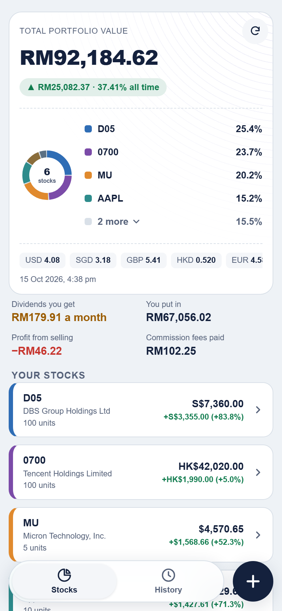
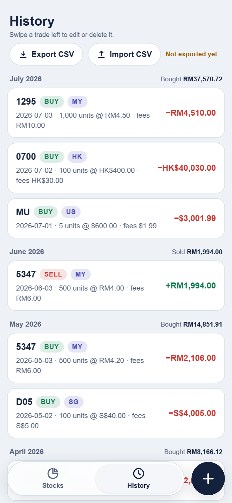
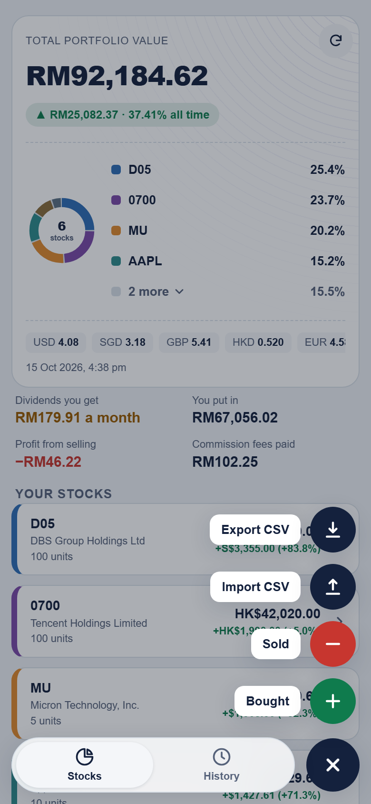

# Ticker Hub

A personal stock and dividend tracker for Bursa Malaysia and US stocks. Record your buys and sells, see your profit in Malaysian ringgit (MYR), and keep everything on your own phone or computer. No account and no server for your data.

<p align="center">
  
  
  
</p>
<p align="center"><sub>Screenshots use sample trades, not real ones.</sub></p>

## What it does

- Records buy and sell trades, with commission fees (stamp duty and platform fee) counted in your cost and profit.
- Shows average-cost profit and loss for each stock, with live prices.
- Converts US and other currencies to MYR using live exchange rates.
- Records dividends you actually received, and shows them next to the estimate.
- Shows everything in one currency of your choice (pick it with the little icon on the total card), or Mixed to see each stock in its own currency.
- **Dividends earned:** the Dividends tab works out what each stock paid you (units you held × dividend per share, minus tax), with totals for all time and this year. Each dividend has a **Wallet / Reinvest** switch: Reinvest adds a Buy that raises your units, Wallet keeps it as cash.
- A **Dividends** tab: for each stock you hold, the next ex-dividend date (marked est. when worked out from past dividends), the pay date when known, the last dividend per share, and what the last dividend would pay on your units.
- A **News** tab with three views: **Summary** (Brent oil, the US 10-year yield, the S&P 500, plus Nasdaq, VIX, KLCI, gold and USD/MYR), **Stocks** (headlines about the stocks you hold) and **Others** (other Malaysian and US market headlines from Bernama, Malay Mail, FMT, CNBC and MarketWatch). Stocks and Others have a month calendar: pick a day, tap a headline to read it on the original site. Headlines are saved on your phone as the app opens, so earlier days fill in over time.
- Deleted a trade by mistake? An **Undo** button shows for a few seconds after every delete.
- Select several trades in History and delete them in one go.
- Shows the latest news headlines for each stock when you open its card (from Yahoo Finance; some Bursa stocks have none).
- Searches stocks by name, so you can type "micron" and pick the ticker.
- Imports trades from CSV or Excel files (Moomoo, Webull, or your own records) and detects the columns for you.
- Exports all your trades to a CSV file.
- Works on a phone like an app, with swipe gestures between pages.

Your trades are saved in your own browser (IndexedDB). They are never sent anywhere. Export a CSV now and then as a backup, because clearing your browser data also clears your trades.

## How to use it

1. **Add a trade:** tap the **+** button, then **Bought**, **Sold** or **Dividend** (cash you received). Type a stock name, pick it from the list, then fill in the date, number of units, price and fees.
2. **Change currency:** tap the little globe or banknote icon on the total card to show everything in MYR, USD, SGD, HKD, GBP or EUR. Mixed shows each stock in its own currency.
3. **See your stocks:** the **Stocks** page shows your total value, a ring chart of your holdings, and a card for each stock. Tap a card for details. Pull down to refresh prices.
4. **See your history:** the **History** page lists every trade by month. Swipe a trade left to edit or delete it, or tap the tick box at the top to select several and delete them together.
5. **Move between pages:** tap **Stocks** or **History**, or drag the tab bar, or swipe the page sideways.
6. **Import:** tap **+**, then **Import CSV**. Choose a file, check the preview, then confirm. Trades you already have are skipped.
7. **Export:** tap **+**, then **Export CSV**.

## Set it up yourself

You need a free [Cloudflare](https://dash.cloudflare.com) account and [Node.js](https://nodejs.org) (only for the local preview).

1. **Create the price worker.** In Cloudflare, go to Workers & Pages, create a Worker, paste in the contents of `worker.js`, and deploy it. Copy its address, such as `https://yourworker.yourname.workers.dev`.
2. **Add your worker address.** Copy `app/js/config.example.js` to `app/js/config.js` and put your worker address in it. `config.js` is ignored by git, so your address is not published.
3. **Try it on your computer.** Run `npm run dev` (or double-click `preview.bat`). The app opens in your browser.
4. **Put it online.** In Cloudflare, go to Workers & Pages, create a Pages project with "Upload assets", and drag in the `app` folder. You get a free `yourname.pages.dev` address. To update later, upload the `app` folder again.
5. **Use it on your phone.** Open your address in the phone's browser and choose "Add to Home Screen".

## Project layout

```
app/          the website (this is what you upload)
  js/         the app code (Vue 3, no build step)
  css/        styles
worker.js     the Cloudflare Worker that fetches prices, rates and stock search
preview.js    small local server for trying the app on your computer
```

Built with Vue 3 (included in `app/js/vendor`), plain CSS, and a Cloudflare Worker that reads Yahoo Finance data (prices, exchange rates, stock search, and news feeds).

## Disclaimer

For personal record keeping only. Prices come from a free data source and may be delayed or wrong. This is not financial advice.
